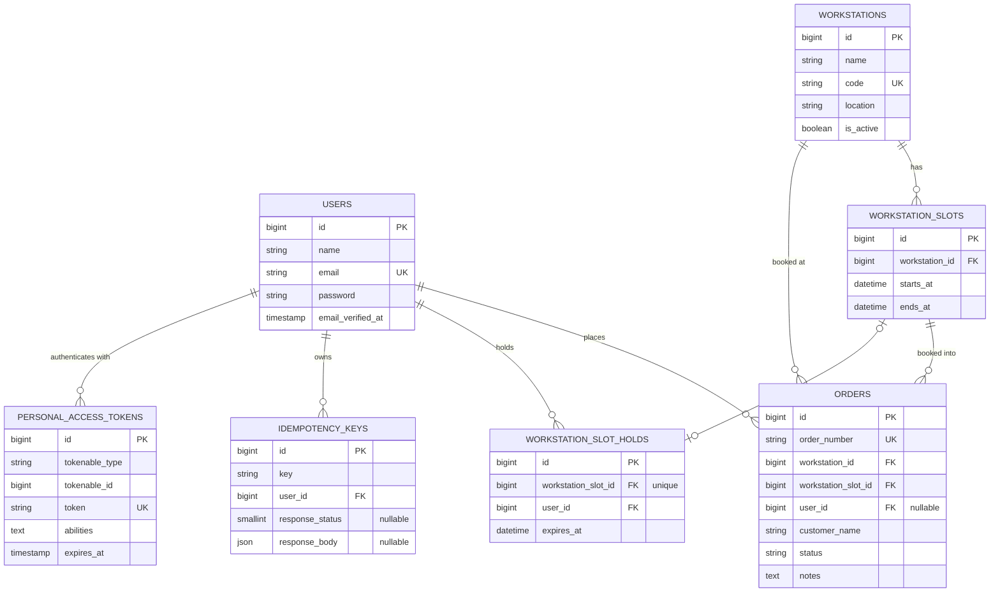

# Workstation Booking (Laravel & Flutter)

A time-sloted workstation booking system: a Laravel REST API backend and a Flutter client that
consumes it. A customer picks a workstation, holds a time slot while confirming details, then
books it into an order; orders move through a small status workflow from there.

This repo is a monorepo:

```
hello-laravel/        # Laravel 13 API (this directory)
flutter_app/           # Flutter client (order_app) — web, desktop, mobile
```

## Domain model

- A **Workstation** has many **Slots** (fixed time windows).
- A **Slot** can have at most one active **Hold** (a short-lived claim by a user) and any
  number of **Orders** over its lifetime — availability is derived from whether an order
  exists in a non-cancelled status, not stored as a flag, so cancelled bookings remain in
  history.
- An **Order** is the booking itself (no separate line items) and carries a status:
  `pending → in_progress → completed`, with `cancelled` reachable from `pending` or
  `in_progress`. `completed` and `cancelled` are terminal.

### Entity-relationship diagram



Notes on cardinality:
- `workstation_slots` has a unique `(workstation_id, starts_at)` pair — one slot per start time
  per workstation. A slot's booked/available status is **derived**, not stored: it's booked if
  any non-cancelled order references it, so cancelled orders remain in history without freeing
  a flag.
- `workstation_slot_holds.workstation_slot_id` is unique — at most one active hold per slot,
  enforced at the database level as a backstop to the row-locked application logic in
  `HoldSlotUseCase`.
- `idempotency_keys` is unique on `(user_id, key)`; `response_body`/`response_status` stay null
  while the original request is still in flight, letting a concurrent retry detect "still
  processing" versus "here's the cached response".
- `orders.user_id` is nullable (`nullOnDelete`) but `workstation_id`/`workstation_slot_id` are
  required and `restrictOnDelete` — an order always points at the slot it booked, and that
  workstation/slot can't be deleted out from under it.
- `personal_access_tokens` is Sanctum's token table, polymorphically linked to `users` via
  `tokenable_type`/`tokenable_id`.

---

## Backend — Laravel API

Sanctum-authenticated REST API with OpenAPI docs, built as a feature-organized Clean
Architecture application.

### Features

- **Auth** — register/login with email + password, Sanctum access/refresh token pairs,
  ability-scoped tokens (`access-api` vs `issue-access-token`), logout.
- **Workstations** — CRUD, with a guard against deleting a workstation that has order history.
- **Slots & holds** — list a workstation's time slots for a day with live status
  (`available` / `held` / `held_by_you` / `booked`); temporarily hold a slot while a customer
  is on the confirm screen, with a renewable TTL capped at a hard maximum so nobody can sit on
  a slot forever.
- **Orders** — book a held (or free) slot into an order, list/filter by status and
  workstation, update customer details, and move an order through its status state machine.
  Cancelling or deleting a pending order frees its slot.
- **Idempotent booking** — send an `Idempotency-Key` header on `POST /api/orders` so retrying
  after a lost response (common on flaky mobile networks) replays the original result instead
  of double-booking.
- **API docs** — OpenAPI/Swagger UI generated from PHP attributes via L5-Swagger.
- **Telescope** — local request/query/job introspection.

### Architecture

The codebase is organized **by feature first, then by Clean Architecture layer** — each
business domain under `app/Domain/*` is a self-contained vertical slice:

```
app/Domain/<Feature>/
    Domain/            # Repository interfaces ("ports"), enums, domain exceptions
    Application/        # Use Cases — one per business operation, depend only on ports
    Infrastructure/      # Eloquent models + repository implementations ("adapters")
    Presentation/        # HTTP controllers, form requests, API resources, middleware
```

Features: `Auth`, `Workstation`, `Order`, `Idempotency`, plus a `Shared` feature holding the
cross-cutting `TransactionManager` port.

**Dependency rule:** Application-layer Use Cases depend only on `Domain` interfaces, never on
Eloquent models or Laravel facades directly. Every interface is bound to its concrete
Infrastructure implementation in a single place — [`AppServiceProvider`](app/Providers/AppServiceProvider.php) —
so swapping an implementation (a fake in a test, a different persistence backend) never
touches a Use Case or controller. This is verified directly in
[`tests/Feature/DependencyInjectionTest.php`](tests/Feature/DependencyInjectionTest.php), which
swaps in a stand-in implementation at runtime and asserts the controllers never notice.

This is a **pragmatic** take on Clean Architecture: Eloquent models double as the domain model
(no separate plain-PHP entities/mappers), and framework conveniences that don't threaten the
dependency rule — route-model binding, Laravel's declarative validation rules, an
HTTP-aware domain exception rendering its own `JsonResponse` — are kept rather than
abstracted away for their own sake.

#### Cross-feature collaboration

Features depend on each other only through ports, never concrete classes, preserving the
dependency rule across domain boundaries:

- `Order`'s `BookSlotUseCase` depends on `Workstation`'s `SlotHolds` and
  `WorkstationSlotHoldRepository` interfaces (to atomically consume a hold when booking).
- `Workstation`'s `HoldSlotUseCase` depends on `Order`'s `OrderRepository` interface (to check
  whether a slot already has an active order before a hold is granted).
- `Workstation`'s `ListWorkstationOrdersUseCase` depends on `Order`'s `OrderRepository`.

`SlotHolds` and `SlotBooking` act as each feature's **input port**: `HoldSlotUseCase`
implements `SlotHolds`, `BookSlotUseCase` implements `SlotBooking`, and other features talk to
them only through those interfaces.

#### Database transactions

A `TransactionManager` port (`App\Domain\Shared\Domain\TransactionManager`) wraps
`DB::transaction()`, so Use Cases that need multi-step consistency (acquiring a hold, booking a
slot) depend on an interface rather than the `DB` facade directly.

### Libraries

Runtime (`composer.json` → `require`):

| Package | Used for |
|---|---|
| `laravel/framework` ^13 | The framework itself |
| `laravel/sanctum` ^4 | API token auth — the access/refresh token pairs and ability scoping |
| `darkaonline/l5-swagger` ^11 | Generates the OpenAPI spec and Swagger UI from the `OA\*` PHP attributes on controllers, served at `/api/documentation` |
| `laravel/tinker` ^3 | REPL for the app (`php artisan tinker`) |

Development (`require-dev`):

| Package | Used for |
|---|---|
| `laravel/telescope` | Local request/query/job/exception introspection at `/telescope` |
| `laravel/pint` | Opinionated code style fixer (`vendor/bin/pint`) |
| `laravel/pail` | Tails the application log in the terminal (`php artisan pail`) |
| `laravel/pao` | Agent-optimized output for PHP testing tools (PHPUnit/Pest/etc.) — compact, parseable test results for AI coding agents |
| `phpunit/phpunit` | The test runner |
| `mockery/mockery` | Mocking library used in tests |
| `fakerphp/faker` | Generates fake data for model factories and seeders |
| `nunomaduro/collision` | Readable CLI error/stack-trace output |

### API surface

All business endpoints require `Authorization: Bearer <access_token>` and the token's
`access-api` ability. Interactive docs are at `/api/documentation` once the app is running.

| Method | Path | Description |
|---|---|---|
| POST | `/api/register` | Create an account, returns a token pair |
| POST | `/api/login` | Returns a token pair |
| POST | `/api/refresh` | Exchange a refresh token for a new access token |
| GET | `/api/user` | Current authenticated user |
| POST | `/api/logout` | Revoke the current token |
| GET/POST | `/api/workstations` | List / create workstations |
| GET/PUT/DELETE | `/api/workstations/{workstation}` | Show / update / delete a workstation |
| GET | `/api/workstations/{workstation}/slots` | List a workstation's slots with status |
| GET | `/api/workstations/{workstation}/orders` | List a workstation's orders |
| POST/DELETE | `/api/workstation-slots/{slot}/hold` | Hold / release a slot |
| GET/POST | `/api/orders` | List (filterable by `status`, `workstation_id`) / book a slot |
| GET/PUT/DELETE | `/api/orders/{order}` | Show / update / delete an order |
| PATCH | `/api/orders/{order}/status` | Transition an order's status |

### Requirements

- PHP ^8.3
- Composer
- A database (MariaDB/MySQL recommended; SQLite also works for local dev)

### Setup

```bash
composer install
cp .env.example .env
php artisan key:generate
```

Configure your database connection in `.env`, then:

```bash
php artisan migrate --seed
```

Seeding creates sample workstations/slots, demo orders, and a test user you can log in with:

| Email | Password |
|---|---|
| `test@example.com` | `password` |

#### Configuration

Slot hold timing is configured via [`config/booking.php`](config/booking.php):

| Env var | Default | Meaning |
|---|---|---|
| `SLOT_HOLD_TTL` | 180s | How long a hold lasts before it can be reused by someone else |
| `SLOT_HOLD_MAX` | 600s | Hard cap on total hold time, even across renewals |

### Running the app

```bash
php artisan serve
```

Stop it with `Ctrl+C` in that terminal, or if it's running elsewhere:

```powershell
Get-NetTCPConnection -LocalPort 8000 | Select-Object -ExpandProperty OwningProcess | ForEach-Object { Stop-Process -Id $_ -Force }
```

#### API documentation

```bash
php artisan l5-swagger:generate
```

Then browse to `/api/documentation`.

### Testing

```bash
php artisan test
```

Tests cover the auth flow, workstation/order APIs, slot hold lifecycle and conflicts
(including concurrent-hold races), idempotent order creation, and — in
[`DependencyInjectionTest`](tests/Feature/DependencyInjectionTest.php) — that controllers
depend only on the port interfaces, not concrete Use Case classes.

### Tooling

- [Laravel Pint](https://laravel.com/docs/pint) for code style: `vendor/bin/pint`
- [Laravel Telescope](https://laravel.com/docs/telescope) for local debugging, available at
  `/telescope`
- [Laravel Boost](https://laravel.com/docs/ai) is configured for AI coding agents — see
  [`AGENTS.md`](AGENTS.md) for agent-specific guidelines.

---

## Frontend — Flutter app (`flutter_app/`)

A Flutter client (package name `order_app`) for the API above, runnable on web, desktop, and
mobile. Built with Riverpod and a per-feature MVVM layout that mirrors the backend's
feature-first organization.

### Features

- **Auth** — login and registration screens, backed by the API's token-pair auth; an
  `AuthGate` widget switches between the login flow and the main app based on session state.
- **Workstations** — browse the list of workstations.
- **Booking** — pick an available slot for a workstation (live status per slot), hold it,
  confirm booking details, and view/manage resulting orders — both "my orders" and
  per-workstation order lists.
- **Responsive shell** — `HomeShell` uses a `NavigationRail` on wide windows (web/desktop/tablet)
  and a bottom `NavigationBar` on narrow ones (phones), with a shared account menu for logout.

### Architecture

Each feature under `lib/features/<feature>/` is layered the same way:

```
lib/features/<feature>/
    domain/             # Entities + repository interfaces
    data/               # Remote data sources, mappers, repository implementations
    presentation/
        viewmodel/       # State + business logic per screen (ChangeNotifier-style)
        view/            # Screens (widgets), driven by a ViewModel
        providers/       # Riverpod providers wiring data sources → repos → ViewModels
        widgets/         # Feature-local reusable widgets
```

Shared infrastructure lives under `lib/core/`:

- `network/api_client.dart` — thin HTTP wrapper used by every remote data source. Attaches the
  stored access token, and transparently recovers from an expired one: on a 401 it calls
  `POST /refresh` with the stored refresh token, saves the new pair, and retries the original
  request once. If the refresh token is also gone, it fires `onSessionExpired` so the app can
  drop back to the login screen.
- `network/token_storage.dart` — persists the access/refresh token pair via `shared_preferences`
  (works identically on mobile and web with no platform-specific setup).
- `config/api_config.dart` — resolves the API base URL per platform (see below).
- `error/failure.dart`, `network/failure_mapper.dart` — map API/network errors into typed
  failures the UI can render consistently.

Features depend on each other only through what `HomeShell` wires up explicitly (e.g. the
workstations screen is handed an `onOrder` callback rather than importing the booking feature
directly), keeping each feature independently testable.

### Libraries

Runtime (`pubspec.yaml` → `dependencies`):

| Package | Used for |
|---|---|
| `flutter_riverpod` ^3 | State management and dependency injection — providers wire data sources → repositories → ViewModels (`lib/core/di/core_providers.dart` and each feature's `presentation/providers/`) |
| `http` ^1.2 | The underlying HTTP client used by `ApiClient` |
| `shared_preferences` ^2.3 | Persists the access/refresh token pair between app launches (`TokenStorage`) |
| `uuid` ^4.5 | Generates the client-side `Idempotency-Key` sent with `POST /api/orders` |
| `intl` ^0.20 | Date/time formatting on the slot picker, order list, and order detail screens |
| `cupertino_icons` ^2.0 | iOS-style icon set |
| `provider` ^6.1 | Listed as a dependency but not currently imported anywhere in `lib/` — state management went to `flutter_riverpod` instead; safe to remove if nothing picks it back up |

Development (`dev_dependencies`):

| Package | Used for |
|---|---|
| `flutter_test` | Widget/unit testing framework |
| `flutter_lints` ^6 | Recommended lint rule set (`analysis_options.yaml`) |
| `fake_async` ^1.3 | Deterministic testing of timer-based code, e.g. the slot hold countdown |

### Requirements

- Flutter SDK (Dart ^3.13.3)
- The Laravel API running and reachable from wherever the app runs

### Running the app

```bash
cd flutter_app
flutter pub get
flutter run
```

The API base URL is resolved automatically per platform in
[`lib/core/config/api_config.dart`](flutter_app/lib/core/config/api_config.dart), since
`127.0.0.1` means a different machine depending on who's asking:

| Target | Default base URL |
|---|---|
| Web / Windows desktop / iOS simulator | `http://127.0.0.1:8000/api` |
| Android emulator | `http://10.0.2.2:8000/api` (emulator's alias for the host) |
| A real device on the same Wi-Fi | not covered by defaults — override it (see below) |

Override for any target, e.g. to point at your machine's LAN IP for a real device:

```bash
flutter run --dart-define=API_BASE_URL=http://192.168.1.23:8000/api
```

### Testing

```bash
cd flutter_app
flutter test
```

## License

The Laravel framework is open-sourced software licensed under the [MIT license](https://opensource.org/licenses/MIT).
